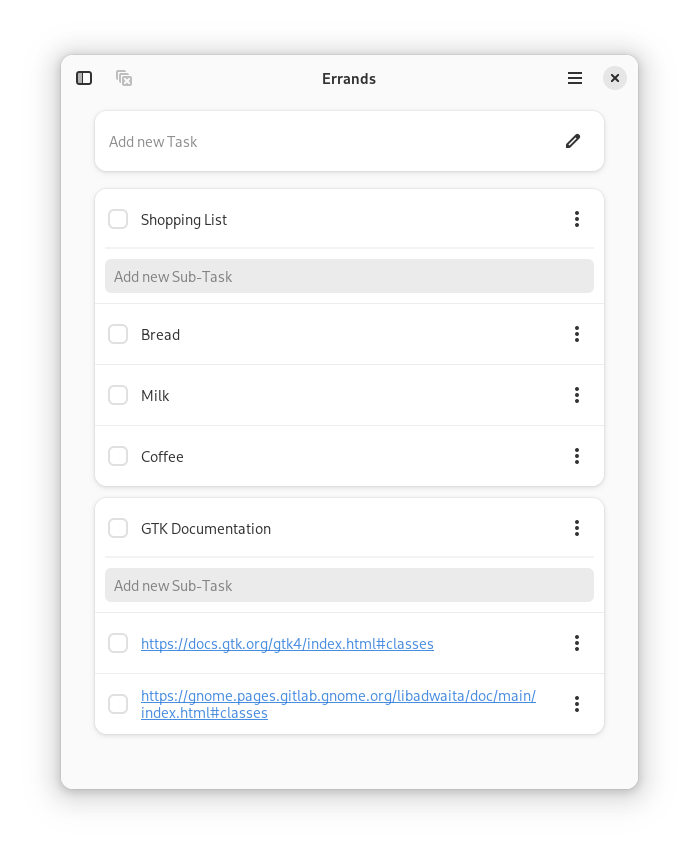

<div align="center">
  

# Errands

Manage your tasks

    <a href="https://circle.gnome.org/"></a>

    <p align="center">
      
    </p>

</div>

> [!WARNING]
> Development branch. Work in progress.

### Building

Dependencies:

- `libadwaita`
- `libsecret`
- `libportal`
- `gtksourceview-5`
- `evolution-data-server`

Build:

```sh
make
```

Run:

```sh
make run
```

Clean:

```sh
make clean
```
