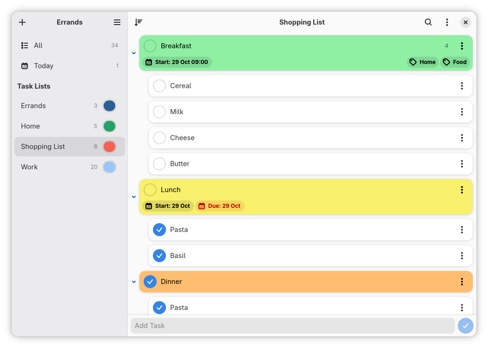
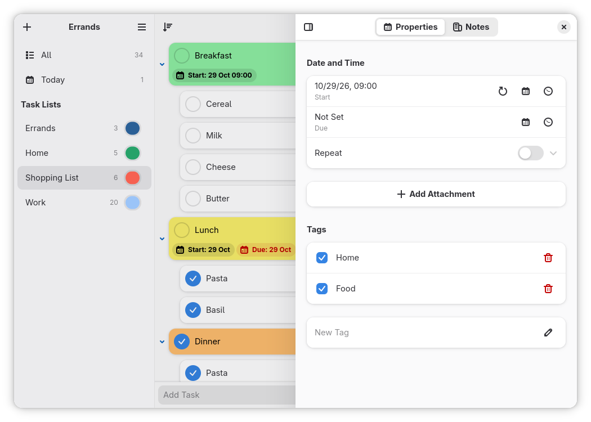

<div align="center">
  

<h1>Errands</h1>

<p>Manage your tasks<p>

<a href="https://circle.gnome.org/">
  
</a>

<p align="center">
    
    
</p>

</div>

## Install

Install official flatpak from Flathub:

<a href='https://flathub.org/apps/io.github.mrvladus.List'>
    
</a>

## Build

Use [Gnome Builder](https://flathub.org/en/apps/org.gnome.Builder) for building Flatpak.

## Develop

Setup distrobox container:

```sh
make distrobox-setup
```

Build and run:

```sh
make DEVEL=TRUE run
```

Cleanup:

```sh
make clean
```

Look into [Makefile](./Makefile) for more options.
